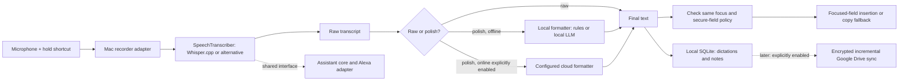

# Offline-first dictation: proposed design

Status: a development Mac dictation app, shared speech adapters, dictation processing core, and a native focus guard are implemented. See [feasibility checks](dictation-feasibility.md) for tested native, browser and offline behavior. Real microphone and full live insertion need verification after permissions. Dictation storage, notes UI, Google OAuth, sync, and an iOS app are not implemented. Decisions involving permissions, retention, encryption and UX still need confirmation before the relevant milestone.

## Goal and boundaries

Build a Mac-first push-to-talk dictation app that can insert text at the user's cursor. Keep assistant, Alexa and dictation as separate adapters using shared speech interfaces. Dictation and notes are user data, not assistant instructions, and must never trigger memory tools, sending email or other actions. Modes are explicit: `raw` returns the speech recognizer's text exactly (not the original audio or a guarantee of verbatim accuracy); `polish` runs a selected formatter. Offline must work without credentials or network. Online formatting is a separate, visible, user-controlled mode and must not silently send text or surrounding context to a provider.

## Platform and UX

- A native macOS menu-bar adapter is a candidate for keyboard shortcuts, status, target-app identification, permissions and insertion; reusable TypeScript code and local speech subprocesses can remain separate. The globally selected Command Line Tools Swift/SDK combination had a mismatch; the installed Xcode toolchain successfully compiled AppKit and AVFoundation when selected for the command via `DEVELOPER_DIR`.
- Input Monitoring, microphone and Accessibility are separate macOS permissions. Explain and request the relevant OS prompt only when the feature is used; do not claim success without testing.
- `native/macos/FocusedTarget.swift` captures and revalidates the frontmost app, focused field and selection without reading field contents. The development app uses it for single-line Unicode event insertion, which cannot guarantee delivery or recognize every secure field. Capture the focused app and target at the start of dictation; before inserting, verify the app/element has not changed. If identity or editability cannot be verified, retain the result for explicit review/copy instead of writing into a different field. In a disposable Chrome test, an accessibility write reported success without changing the text; targeted Unicode keyboard events worked in that controlled test. Avoid retrying automatically when delivery is uncertain, which could duplicate text. This requires careful testing across native, browser and Electron apps; accessibility APIs can return unsupported or invalid elements.
- Refuse secure/password fields where reliably identified. Provide explicit excluded-app and no-history options; do not read surrounding content, clipboard, screen, or browser pages by default. Accessibility cannot guarantee secure-field detection for every third-party app, so use conservative fallback and test real targets.
- Treat app identity as a hint, not proof of content type: Gmail and chat can run in the same browser, and the focused element may not expose semantics. Provide explicit `plain`, `email`, and `code` style controls, with optional app-based suggestions. Do not invent a recipient, facts, or sender name; avoid adding a signature or salutation in the middle of an existing message. Insertion only writes text; it never sends the email.
- Raw mode and an offline fallback must still work if the local model is absent, slow, or fails. A text model may change names, dates or code; never replace the raw transcript in storage. Detect empty or likely non-speech results, expose the result and failure state, and provide undo/retry where feasible.
- iOS is a separate future adapter, not a guarantee of Mac-like system-wide insertion. Apple's custom-keyboard restrictions include secure fields, certain number fields, and host apps that disallow third-party keyboards. Apple documentation indicates keyboard extensions cannot access the microphone; a containing-app recording and handoff needs a separate feasibility prototype and privacy review. Full Access is required for network and shared-container writes and must be a user choice.

## Speech and formatting interfaces

Existing `src/speech/transcription.ts` defines a transcriber and Whisper.cpp adapter; `src/speech/synthesis.ts` defines the Mithi adapter. `src/speech/process.ts` keeps provider credentials out of speech subprocesses. Both adapters require local assets and are Mac-oriented: a native iOS build may implement the same concepts with a different runtime, rather than reuse Node binaries.

Start with installed multilingual Whisper `small` as a tested local baseline. Compare on actual English, Hindi, Hinglish, proper nouns and code dictated by the user, with consent. Qwen3-ASR 0.6B supports English and Hindi according to its model card and is a candidate for a later benchmark, not installed or measured here. STT produces text; it does not guarantee faithful formatting or polished prose.

Formatter contract: `format(rawText, style, { outputMode, targetLanguage, polish }) -> text`. The source transcript is preserved separately. `spoken` retains detected language and script; `romanize` changes non-Latin script to Latin letters without translation; `translate` converts to a selected target language. Raw + spoken is pass-through. Raw + romanize/translate invokes only the explicitly selected conversion; polish combines language/script conversion with the selected writing style. Store the selected output mode/target alongside the transcript. Prompt instructions can improve self-correction handling but cannot guarantee correct interpretation of every ambiguous utterance; maintain synthetic regression examples and preserve uncertainty instead of guessing. The experimental local formatter uses Ollama and receives no surrounding field context. Cloud providers use the existing configured chain; when a user explicitly selects conversion, the transcript is sent to that chain, which falls back locally on failure. External text is untrusted input, not an instruction source.

## Local data: proposed, not implemented

Use a separate SQLite database from Alexa/assistant history, with migrations and owner-only files, rather than silently mixing dictation content into assistant memory. Proposed records:

- `dictations`: UUID; dictated timestamp; raw transcript; final text; raw/polish mode; explicit style; selected engine/model/version; created/updated/deleted timestamps; output/delivery status. Do not retain raw audio by default.
- `notes`: UUID; title; text; created/updated timestamps; deletion tombstone.
- `sync_outbox` and `sync_state`: device ID, immutable operation UUID, record ID/type, logical version, payload or payload reference, retry state and remote cursor; no OAuth tokens.

Decide default retention, explicit history enablement, deletion, local encryption and encrypted backups before storing real dictation. The user requested history; storage should be visible and configurable. File permissions and FileVault help protect the Mac but are not per-record end-to-end encryption, and backups and deleted SQLite pages may retain copies. Sync must be opt-in. Do not log raw/final text, input-context contents, tokens, or audio.

## Proposed Drive sync

Google Drive API standard usage has published quotas and no additional cost for standard use; storage and quota terms can change, and paid quota/billing must not be enabled without user approval. Sign-in happens later through Google OAuth in a browser with PKCE and the minimum scope, with refresh tokens in platform Keychain. `drive.appdata` is a candidate for hidden application data; its visibility and lifecycle are different from a normal Drive folder. Verify that the intended Mac and iOS OAuth clients in the same Google project can access the same app data, and validate account/test-mode and policy constraints before choosing it. If the user wants directly visible files, consider a separate app-created folder and suitable scope instead.

Do not sync a live SQLite database or maintain one shared, overwritten JSON file. A proposed first protocol uses immutable JSON operation files named by stable random operation IDs: each contains schema version, device ID, record ID, operation ID, logical base/version, kind, and encrypted payload. A local transaction writes the record and outbox entry together. A retry reuses the same operation ID; a receiver deduplicates IDs locally. Drive file-name uniqueness is not guaranteed, so concurrent retry duplicates must be deduplicated by operation ID rather than names alone. Batch/compact later only after correctness is tested.

For initial sync, obtain a changes start token before listing and importing existing app files, then replay changes from that token so writes during bootstrap are not missed. Later runs use Drive `changes.list` with `spaces=appDataFolder` and a persisted page token, process pages transactionally, and persist the final cursor only after successfully applying changes; recover from invalid tokens by a safe re-scan. Changes report current file state, not content diffs. Network loss and process termination leave the outbox for retry.

For concurrent edits, use record versions and preserve both conflicting note versions for user review rather than assume that clocks or last-write-wins protect data. Deletion uses tombstones so an offline device cannot resurrect records; tombstone collection needs a policy accounting for long-offline devices. Test two-device concurrent edits, duplicate uploads, deletes, retry, bootstrap, offline restart, token expiry and encryption recovery before relying on sync. Design client-side authenticated encryption and cross-device key recovery before syncing personal data; Google Drive encryption alone does not provide the user-controlled end-to-end property.

## Incremental milestones

1. Shared speech ports and a raw/polish dictation processing core with an experimental local formatter (implemented; adapter and offline-boundary tests passed, real target and live assistant regression pending).
2. A small Mac raw-dictation slice: hold shortcut, local transcription, explicit safe output/preview or focused-field insertion as chosen, permission handling and user testing. No automatic context reads, cloud, sync or personal-history persistence until those policies are settled.
3. Add local SQLite dictation history and notes, explicit retention/deletion and protection decisions. Verify restart, inspection, deletion and backup/restore.
4. Add explicit raw / offline polish / online polish modes and style selection. Evaluate local models with synthetic and user-consented real samples; measure latency, quality and unintended changes.
5. Add optional Google OAuth and sync in isolation, followed by two-device conflict and recovery tests. Never enable billing or ask for keys in chat.
6. Independently assess native iOS recording, keyboard handoff and safe insertion, sharing domain contracts where appropriate. Do not promise universal keyboard mic access.

## Sources

- [Apple custom keyboard restrictions](https://developer.apple.com/documentation/uikit/configuring-a-custom-keyboard-interface), [keyboard open-access restrictions](https://developer.apple.com/documentation/uikit/configuring-open-access-for-a-custom-keyboard), [Accessibility API errors](https://developer.apple.com/documentation/applicationservices/1462085-axuielementcopyattributevalue)
- [Google Drive application data](https://developers.google.com/workspace/drive/api/guides/appdata), [changes and cursors](https://developers.google.com/workspace/drive/api/guides/about-changes), [changes.list spaces](https://developers.google.com/workspace/drive/api/reference/rest/v3/changes/list), [Drive quotas and pricing](https://developers.google.com/workspace/drive/api/guides/limits), [desktop OAuth and PKCE](https://developers.google.com/identity/protocols/oauth2/native-app)
- [Whisper.cpp](https://github.com/ggml-org/whisper.cpp), [Qwen3-ASR 0.6B model card](https://huggingface.co/Qwen/Qwen3-ASR-0.6B), [Ollama Qwen3 model variants](https://ollama.com/library/qwen3/tags), [Qwen3 1.7B model card](https://huggingface.co/Qwen/Qwen3-1.7B)
